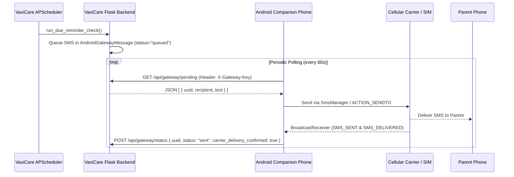

# VaxiCare Android SIM-Based SMS Gateway Companion

## 1. Architectural Overview

The **VaxiCare Android SIM-Based SMS Gateway** is an optional companion system that enables accredited community Primary Health Centres (PHCs) or field health workers to dispatch ordinary cellular SMS notifications directly through a designated Android smartphone equipped with a local SIM card, without requiring paid third-party cloud aggregators (e.g., Twilio).



---

## 2. Google Play Store Permission & Compliance Analysis

> [!WARNING]
> **Google Play Store Policy on `SEND_SMS` and `READ_SMS`**:  
> In accordance with Google Play's Permissions policy (Google Play Console Policy update 2019+), background access to the `android.permission.SEND_SMS` permission is strictly restricted only to applications that the user has selected as their **Default SMS Handler** or enterprise/sideloaded APKs distributed via Mobile Device Management (MDM).

### Approved Modes of Operation:

1. **Enterprise / Sideloaded PHC APK (Automated Sending):**
   - Health department phones provisioned directly by health centres or downloaded as an internal `.apk`.
   - Uses `android.telephony.SmsManager.getDefault().sendTextMessage(...)` with `PendingIntent` callback receivers for `SMS_SENT` and `SMS_DELIVERED`.
   - Completely automated without user interaction.

2. **Google Play Compliant Mode (Human-Confirmed Intent):**
   - Uses the standard Android Intent `Intent(Intent.ACTION_SENDTO, Uri.parse("smsto:" + recipient))`.
   - Pre-fills the recipient and immunization text into the user's default messaging app.
   - Requires the healthcare worker to tap "Send" once, ensuring 100% compliance with Google Play Store distribution guidelines without triggering policy violations.

---

## 3. Security, Authentication & Anti-Abuse Controls

- **Mutual Authentication:** Every companion phone is registered in the VaxiCare Administrative Center (`/admin/notifications?channel=android_gateway`). A 40-character cryptographic API key is generated and hashed with SHA-256 in the database.
- **Header Authentication:** The Android companion supplies the key in the `X-Gateway-Key` request header.
- **Idempotency & Duplicate Prevention:** Every message is tracked with a UUID4 identifier. Re-retrieving the queue marks messages as `assigned` to prevent concurrent dispatch across multiple PHC devices.
- **Parent Consent Gating:** The Flask backend will only queue messages for parents who have explicitly enabled `sms_consent = True`.
- **Delivery Confirmation:** The gateway explicitly distinguishes between `status="sent"` (transmitted from phone to cell tower) and `carrier_delivery_confirmed = true` (carrier delivery receipt received via `DELIVERY_INTENT`).

---

## 4. REST API Specification

### 4.1 Fetch Pending Messages
- **Endpoint:** `GET /api/gateway/pending?limit=10`
- **Header:** `X-Gateway-Key: <api_key>`
- **Response:**
  ```json
  {
    "status": "ok",
    "device": "Rampur PHC Field Phone 1",
    "count": 1,
    "messages": [
      {
        "uuid": "4f9e160f-21cb-42b7-8854-463dfb12e35a",
        "recipient": "+919876543210",
        "text": "VaxiCare Reminder: Aarav Sharma is due for Pentavalent 1 on 15 Nov 2026."
      }
    ]
  }
  ```

### 4.2 Report Dispatch Status
- **Endpoint:** `POST /api/gateway/status`
- **Header:** `X-Gateway-Key: <api_key>`
- **Body:**
  ```json
  {
    "uuid": "4f9e160f-21cb-42b7-8854-463dfb12e35a",
    "status": "sent",
    "error": null,
    "delivery_confirmed": true
  }
  ```

### 4.3 Device Heartbeat
- **Endpoint:** `POST /api/gateway/heartbeat`
- **Header:** `X-Gateway-Key: <api_key>`
- **Response:**
  ```json
  {
    "status": "ok",
    "device": "Rampur PHC Field Phone 1",
    "time": "2026-11-15T16:00:00Z"
  }
  ```
